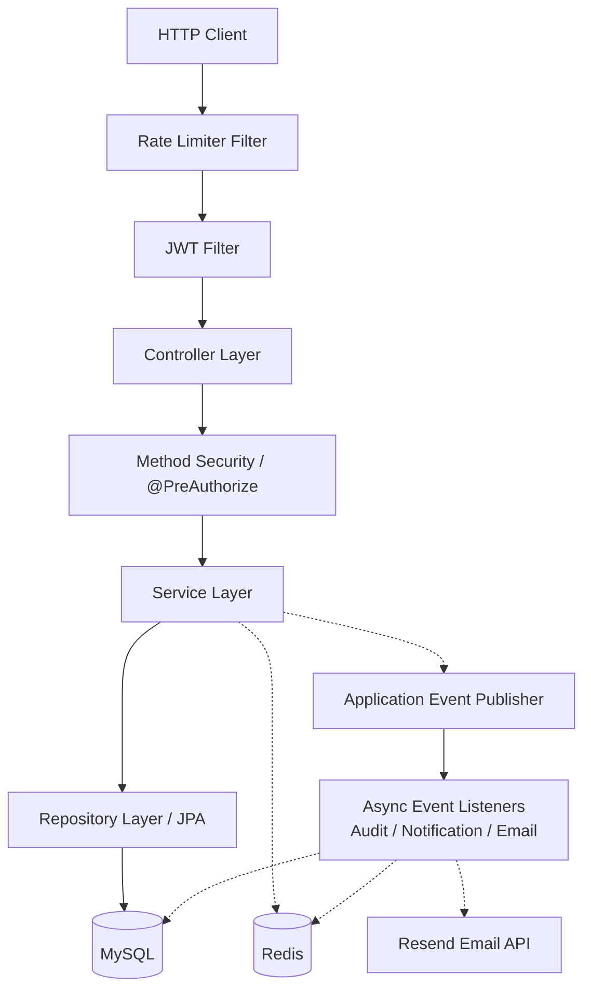
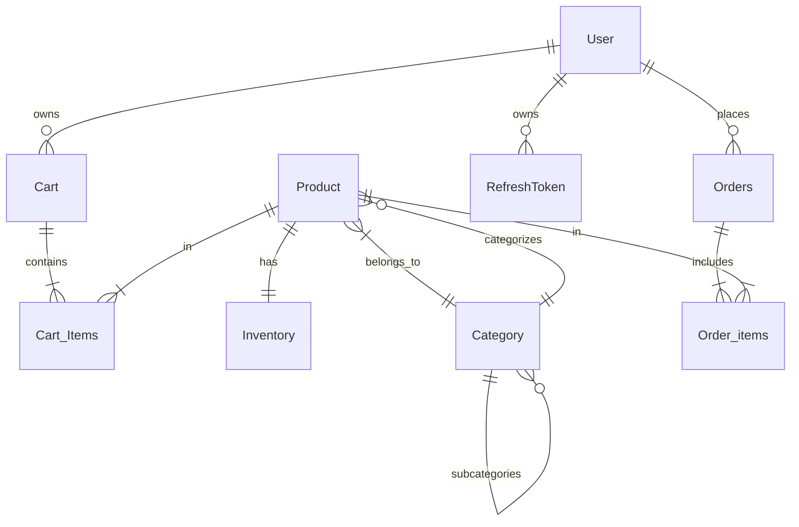

# E-Commerce Backend (Spring Boot)

A RESTful e-commerce backend built with **Spring Boot 3.3.5** and **Java 21**. It provides user registration and authentication (JWT with refresh-token rotation), product and category management, shopping cart, order placement with inventory deduction and restoration, role-based authorization, Redis-based caching and rate limiting, optimistic locking for inventory concurrency, and a global exception-handling layer. The project is intended as a backend engineering portfolio piece demonstrating layered architecture, transactional service boundaries, and production-oriented configuration.

## Table of Contents

1. [Project Status](#project-status)
2. [Key Features](#key-features)
3. [Technology Stack](#technology-stack)
4. [Architecture Overview](#architecture-overview)
5. [Repository Structure](#repository-structure)
6. [Database Design and Entity Relationships](#database-design-and-entity-relationships)
7. [Authentication and Security Architecture](#authentication-and-security-architecture)
8. [API Documentation](#api-documentation)
9. [Business Logic and Critical Workflows](#business-logic-and-critical-workflows)
10. [Transactions and Concurrency Control](#transactions-and-concurrency-control)
11. [Redis Integration and Performance](#redis-integration-and-performance)
12. [Error Handling and Validation](#error-handling-and-validation)
13. [Prerequisites](#prerequisites)
14. [Installation and Local Setup](#installation-and-local-setup)
15. [Environment Variables and Configuration](#environment-variables-and-configuration)
16. [Running Tests](#running-tests)
17. [Docker and Containerization](#docker-and-containerization)
18. [CI/CD and Deployment](#ci-cd-and-deployment)
19. [Design Decisions and Engineering Trade-offs](#design-decisions-and-engineering-trade-offs)
20. [Known Limitations and Future Improvements](#known-limitations-and-future-improvements)
21. [Security Considerations](#security-considerations)
22. [Troubleshooting](#troubleshooting)
23. [Learning Outcomes and Engineering Skills](#learning-outcomes-and-engineering-skills)
24. [Contribution Guidelines](#contribution-guidelines)
25. [License](#license)
26. [Author and Project Links](#author-and-project-links)

## Project Status

| Area | Status | Notes |
| ---- | ------ | ----- |
| Core API (auth, products, cart, orders) | Implemented and verified | Covered by unit and integration tests |
| Authentication and authorization | Implemented and verified | JWT access + refresh tokens, RBAC, login lockout |
| Inventory and order consistency | Implemented, verification incomplete | `@Version` optimistic locking on `Inventory`; concurrency test exists for inventory only |
| Automated testing | Implemented and verified | 84 unit tests, all passing (see [Running Tests](#running-tests)) |
| API documentation | Implemented | Springdoc OpenAPI at `/v3/api-docs` and Swagger UI |
| Containerization | Implemented | `Dockerfile` and `docker-compose.yml` present |
| CI/CD | Implemented (build only) | GitHub Actions builds and builds Docker image; test step commented out |
| Deployment | Not verified | No deployment pipeline or live deployment evidence |

## Key Features

### Authentication and Authorization

| Feature | Endpoint | Description | Security Behavior |
| ------- | -------- | ----------- | ----------------- |
| Registration | `POST /public/user` | Creates a user with the `USER` role by default. Password hashed with `BCryptPasswordEncoder`. | Public; validates email/username uniqueness case-insensitively |
| Login | `POST /auth/login` | Validates credentials against the database; issues JWT access token (30-minute expiry) and refresh token (5-day expiry, SHA-256 hashed). | Public; failed attempts increment Redis counter; lockout after 5 failures for 15 minutes |
| Refresh-token rotation | `POST /auth/refresh` | Consumes presented refresh token (single-use); issues new access token and new refresh token; links old token via `replacedby`. | Public; invalid/expired/already-used tokens rejected |
| Logout | `POST /auth/logout` | Blacklists access token in Redis with TTL matching remaining lifetime; deletes refresh token. | Requires authentication; Redis failure does not break logout (fail-open) |
| Authorization | Path-based rules | `/public/**`, `/auth/*`, Swagger, actuator are public; `/auth/logout` requires authentication; `/admin/**` requires `ROLE_ADMIN`; all others require authentication. | Method-level security (`@EnableMethodSecurity`, `@PreAuthorize`) on admin service methods |
| Session management | — | Stateless session management. | `SessionCreationPolicy.STATELESS` |

### Product Catalog

| Feature | Endpoint | Caching | Notes |
| ------- | -------- | ------- | ----- |
| Public product listing | `GET /public/products` | None at list level | Paginated and sorted via Spring `Pageable` (`page`, `size`, `sort`) |
| Product detail by ID | `GET /public/product/{id}` | `Product` cache, 10-minute TTL | Cache miss reads from MySQL; updates use `@CachePut` |
| Price-filtered listing (expensive) | `GET /public/expensiveproducts` | None | Filters products in a category above `minPrice` |
| Price-filtered listing (cheap) | `GET /public/cheapproducts` | None | Filters products in a category below `maxPrice` |
| Parent-category product listing | `GET /public/parentcategorizedproducts` | None | Only top-level categories supported; child categories return 404 |
| Create product | `POST /admin/product` | None | Creates associated `Inventory` record via cascade save |
| Update product | `PATCH /admin/product/{id}` | `Product` cache updated via `@CachePut` | Requires `ROLE_ADMIN` |
| Delete product | `DELETE /admin/product/{id}` | None | Requires `ROLE_ADMIN` |
| Optimistic locking | `Product` entity carries `@Version` | — | Hibernate optimistic locking on `Product` |

### Category Management (Hierarchy)

| Feature | Endpoint | Caching | Notes |
| ------- | -------- | ------- | ----- |
| Category hierarchy | `Category.parentCategory` + `subCategories` | — | Self-join relationship; supports nested parent/child categories |
| Create category | `POST /admin/category` | Evicts entire `categories` cache | Requires `ROLE_ADMIN`; validates name uniqueness |
| List all categories | `GET /admin/categories` | `Category` cache, 5-minute TTL | Paginated via `Pageable` |
| Category tree | `GET /admin/categorytree/{id}` | `ParentCategory` cache, keyed by category ID | Returns nested tree structure; throws if category not found |

### Shopping Cart

| Operation | Endpoint | Description |
| --------- | -------- | ----------- |
| Cart per user | One-to-one relationship | Auto-created on registration; linked bidirectionally with `User` |
| Add item | `POST /user/cart/product/{productId}` | Adds a `Cart_Items` row or increments quantity if product already exists |
| Remove item | `DELETE /user/cart/product/{productId}` | Removes the matching cart item |
| View cart | `GET /user/cart/cart` | Returns cart contents with product names, IDs, and quantities |
| Clear cart | `DELETE /user/cart/cart` | Removes all items from the cart |
| Persistence | `Cart_Repo` | Cart data persisted in MySQL only; not cached in Redis |

### Order Management

| Operation | Endpoint | Description | Business Rules |
| --------- | -------- | ----------- | -------------- |
| Place order | `POST /user/orders/placeorder` | Reads user's cart, validates non-empty, decrements inventory, creates `Orders` + `Order_items`, clears cart — all in `@Transactional`. | Prices derived from server-side product data (not client-supplied); order status `PENDING` |
| List own orders | `GET /user/orders/orders` | Paginated list of orders owned by the authenticated user. | Requires authentication |
| Get own order | `GET /user/orders/order/{id}` | Returns a single order by ID owned by the authenticated user. | Requires ownership verification |
| Cancel order | `DELETE /user/orders/order/{id}` | Validates transition, restores reserved stock, deletes order within same transaction. | Allowed from `PENDING` or `CONFIRMED`; stock restored via `Inventory_Service.increase_stock` |
| Admin status update | `PATCH /admin/setorderstatus` | Updates order status and publishes `OrderStatusUpdatedEvent` after commit. | Requires `ROLE_ADMIN`; validates allowed transitions |
| Order status enum | `PENDING`, `CONFIRMED`, `PROCESSING`, `SHIPPED`, `DELIVERED`, `CANCELLED` | `DELIVERED` and `CANCELLED` are terminal. | Allowed transitions: `PENDING → CONFIRMED`, `PENDING → CANCELLED`, `CONFIRMED → PROCESSING`, `CONFIRMED → CANCELLED`, `PROCESSING → SHIPPED`, `SHIPPED → DELIVERED` |

### Inventory Management

| Feature | Endpoint | Description | Concurrency Control |
| ------- | -------- | ----------- | ------------------- |
| Available stock | `Inventory.quantity` per product | One-to-one `Inventory` record per product; also tracks `reservedQuantity`. | `@Version` on `Inventory` for optimistic locking |
| Decrease stock | `Inventory_Service.decrease_stock()` | Called on order placement; rejects if `quantity < requested` with `InsufficientStockException`. | Read-modify-write within `@Transactional`; conflict → HTTP 409 |
| Increase stock | `Inventory_Service.increase_stock()` | Called on order cancellation to restore reserved stock. | Read-modify-write within `@Transactional` |
| Add stock (admin) | `POST /admin/addstock/{id}` | Admin operation to increase product inventory. | Requires `ROLE_ADMIN` |
| Remove stock (admin) | `POST /admin/removestock/{id}` | Admin operation to decrease product inventory. | Requires `ROLE_ADMIN`; rejects if insufficient |
| Concurrency test | `InventoryConcurrencyTest` | Integration test verifies two concurrent updates produce one success + one `CONFLICT`. | Optimistic lock conflict detected via `ObjectOptimisticLockingFailureException` |

### Infrastructure and Reliability

| Mechanism | Implementation | Behavior | Notes |
| --------- | -------------- | -------- | ----- |
| Redis caching | Product (10-min TTL), Category (5-min TTL), Parent-category caches | `@Cacheable` / `@CachePut` / `@CacheEvict` on service methods | Product detail cached by ID; category list cached by pageable |
| Cache error handler | `CacheErrorHandler` bean | Fail-open: logs and falls through to database on Redis GET/PUT/EVICT/CLEAR errors | Redis outages do not break requests |
| Token blacklisting | Redis; `TokenBlacklist_Service` | Revoked access tokens stored until natural expiry; `JwtFilter` checks blacklist on each request | Redis failure fails open (treat as not blacklisted) |
| Rate limiting | Redis; `RateLimiterService` + `RateLimiterFilter` | Per-endpoint, per-client counters with TTL; distinct limits per endpoint | Redis failure fails open (allow request) |
| Login-attempt tracking | Redis; `LoginAttemptService` | Failed-login counter; lockout after 5 attempts for 15 minutes | Redis failure fails open (no lockout) |
| Transactions | `@Transactional` on service methods | Order placement, cancellation, user create/update/delete, cart mutations, inventory adjustments | Transactional boundaries at service layer |
| Optimistic locking | `@Version` on `Product` and `Inventory` | Hibernate detects concurrent updates at flush/commit time | `ObjectOptimisticLockingFailureException` → HTTP 409 |
| Async event listeners | `@TransactionalEventListener(AFTER_COMMIT)` + dedicated executors | Order creation/status updates trigger audit logs, notifications, emails | Order creation, notification, email listeners |
| Outbox pattern | `OutboxEvent` entity + `OutboxPublisher` (scheduled every 5s) | Publishes pending `ORDER_CREATED` events; no separate relay processor | PENDING → PROCESSED/FAILED status tracking |
| Actuator | `/actuator/health`, `/actuator/info` | Health and info endpoints exposed | Used by Docker Compose health check |
| Global exception handling | `GlobalExceptionHandler` (`@RestControllerAdvice`) | Consistent `Error_ResponseDto` / `ValidationErrorResponse_Dto` JSON bodies | Maps domain exceptions to appropriate HTTP status codes |

## Technology Stack

| Technology | Actual Version | Purpose |
| ---------- | -------------- | ------- |
| Java | 21 | Language and runtime |
| Spring Boot | 3.3.5 | Application framework |
| Spring Web | 3.3.5 (via Spring Boot) | REST controllers and servlet stack |
| Spring Security | 6.3.x (via Spring Boot 3.3.5) | Authentication, authorization, filter chain |
| Spring Data JPA | 3.3.5 (via Spring Boot) | Data access with Hibernate |
| Hibernate | 6.6.x (via Spring Boot 3.3.5) | JPA provider, optimistic locking (`@Version`) |
| MySQL / MySQL Connector/J | 8.x (runtime) | Relational database |
| Redis / Spring Data Redis | via Spring Boot 3.3.5 | Caching, token blacklisting, rate limiting, login-attempt tracking |
| JWT (JJWT) | 0.11.5 | Access and refresh token signing/validation |
| Maven | 3.9.14 (wrapper) | Build tool |
| JUnit Jupiter | via Spring Boot Starter Test | Unit and integration testing |
| Mockito | via Spring Boot Starter Test | Mocking framework |
| MockMvc | via Spring Boot Starter Test | Controller-layer integration tests |
| Springdoc OpenAPI | 2.6.0 | OpenAPI 3 docs and Swagger UI |
| Testcontainers | via JUnit Jupiter | MySQL container for integration tests |
| Lombok | via compile scope | Boilerplate reduction |
| Resend Java SDK | 4.19.0 | Transactional email (order confirmation) |
| Spring Actuator | via Spring Boot 3.3.5 | Health and info endpoints |
| Docker | — | Container image (`Dockerfile`) |
| Docker Compose | — | Local MySQL + Redis + app (`docker-compose.yml`) |
| GitHub Actions | — | CI workflow (`ci.yml`) |

Only technologies present in `pom.xml`, configuration, or source code are listed above.

## Architecture Overview



### Component Responsibilities

| Layer | Responsibility | Key Packages / Classes |
| ----- | -------------- | ---------------------- |
| Controller | REST endpoints, request/Data transfer binding, HTTP status mapping | `Controllers/Auth_Controller`, `Admin_Controllers`, `User_Controller`, `Cart_Controller`, `Public_Controllers`, `Audit_Controller`, `Notification_Controller`, `Home_controller` |
| Security | Filter chain, JWT validation, token blacklist checks, CORS, rate limiting | `Config/SecurityConfig`, `Config/JwtFilter`, `Config/JwtAuthEntryPoint`, `Config/RateLimiterFilter`, `Config/RateLimiterService` |
| Service | Business logic, transaction boundaries, inventory checks, order status transitions | `Service/AuthService`, `User_Service`, `Product_Service`, `Order_Service`, `Cart_Service`, `Category_Service`, `Inventory_Service`, `TokenBlacklist_Service`, `RefreshTokenService`, `LoginAttemptService` |
| Repository | Spring Data JPA CRUD and custom queries | `Repositories/User_Repo`, `Product_Repo`, `Category_Repo`, `Cart_Repo`, `Order_Repo`, `Inventory_Repo`, `RefreshTokenRepository`, `AuditLogRepository`, `OutboxEventRepository` |
| Entity | JPA domain model with mappings and constraints | `Entities/User`, `Product`, `Category`, `Cart`, `Cart_Items`, `Orders`, `Order_items`, `Inventory`, `RefreshToken`, `Notification`, `AuditLog`, `OutboxEvent` |
| DTO | Request/response objects, validation constraints | `DTOS/AuthRequest`, `AuthResponse`, `UserRequest_Dto`, `ProductRequestDto`, `Order_Dto`, etc. |
| Exceptions | Custom business exceptions and global handler | `Exception/GlobalExceptionHandler`, domain-specific `RuntimeException` subclasses |
| Config | Beans for security, Redis, JWT, async executors, Swagger, email | `Config/JwtUtil`, `RedisConfig`, `AsyncConfig`, `SwaggerSecurityConfig`, `TokenHashUtil`, `EmailConfig` |
| Event Listeners | After-commit async handlers for audit, notification, email | `eventlisteners/AuditEventListener`, `NotificationEventListener`, `EmailEventListener` |

### Typical Request Flow

1. The client sends an HTTP request to a controller endpoint.
2. `RateLimiterFilter` checks Redis-based per-client rate limits; if exceeded, returns 429.
3. `JwtFilter` intercepts requests with a `Bearer` token, checks the Redis blacklist, validates the JWT signature and subject, and populates the Spring Security context.
4. The controller delegates to a service method.
5. The service enforces `@PreAuthorize` rules where applied, performs business validation, and calls repositories.
6. Repositories read/write MySQL via Hibernate/JPA.
7. Where applicable, the service publishes application events; after transaction commit, async listeners write audit logs, notifications, and emails.
8. `GlobalExceptionHandler` catches exceptions and returns a consistent JSON error response.

## Repository Structure

```
ecom/
├── .env.dev                      # Dev environment template (gitignored)
├── .env.prod                     # Prod environment template (gitignored)
├── .github/workflows/ci.yml      # GitHub Actions CI: build + Docker image
├── Dockerfile                    # Multi-stage build (Maven 3.9, Temurin 21)
├── docker-compose.yml            # MySQL 8 + Redis 7 + app
├── mvnw / mvnw.cmd               # Maven wrapper
├── pom.xml                       # Maven build definition
├── src/
│   ├── main/
│   │   ├── java/com/rmtech/ecom/
│   │   │   ├── EcomApplication.java          # Entry point (@SpringBootApplication, @EnableCaching, @EnableScheduling)
│   │   │   ├── Home_controller.java          # Health-check root endpoint
│   │   │   ├── Config/                       # SecurityConfig, JwtFilter, JwtUtil, RedisConfig, RateLimiterService, RateLimiterFilter, AsyncConfig, SwaggerSecurityConfig, TokenHashUtil, EmailConfig, JwtAuthEntryPoint
│   │   │   ├── Controllers/                  # Auth_Controller, Admin_Controllers, Order_Controller, User_Controller, Cart_Controller, Public_Controllers, Audit_Controller, Notification_Controller
│   │   │   ├── Service/                      # AuthService, User_Service, Product_Service, Order_Service, Cart_Service, Category_Service, Inventory_Service, TokenBlacklist_Service, RefreshTokenService, LoginAttemptService, NotificationService, AuditLogService, EmailService, OutboxPublisher, InventoryConcurrencyTestSupportService
│   │   │   ├── Repositories/                 # User_Repo, Product_Repo, Category_Repo, Cart_Repo, Order_Repo, Inventory_Repo, RefreshTokenRepository, AuditLogRepository, OutboxEventRepository
│   │   │   ├── Entities/                     # User, Product, Category, Cart, Cart_Items, Orders, Order_items, Inventory, RefreshToken, Notification, AuditLog, OutboxEvent; enums UserRoles, OrderStatus
│   │   │   ├── DTOS/                         # Request/response DTOs incl. AuthRequest, AuthResponse, UserRequest_Dto, ProductRequestDto, Order_Dto, Cart_Dto, Error_ResponseDto, RateLimitConfig
│   │   │   ├── Exception/                    # GlobalExceptionHandler and domain exceptions
│   │   │   ├── Specifications/               # ProductSpecification (JPA Criteria API)
│   │   │   └── eventlisteners/               # AuditEventListener, NotificationEventListener, EmailEventListener
│   │   └── resources/
│   │       ├── application.properties
│   │       ├── application-dev.properties
│   │       └── application-prod.properties
│   └── test/
│       ├── java/com/rmtech/ecom/
│       │   ├── EcomApplicationTests.java
│       │   ├── unittests/                    # 13 unit test classes (Mockito-based)
│       │   └── integrationtests/             # 8 integration test classes (MockMvc + Testcontainers MySQL)
│       └── resources/application-test.properties
├── target/                         # Build output (gitignored)
└── README.md
```

Generated output (`target/`), IDE caches (`.idea/`, `.vscode/`), and local environment files (`.env.dev`, `.env.prod`) are excluded from version control via `.gitignore`.

## Database Design and Entity Relationships

### Entities

| Entity | Table | Primary Key | Key Fields |
| ------ | ----- | ----------- | ---------- |
| `User` | `users` | `user_id` (Long, `@GeneratedValue`) | `name`, `email` (unique), `password` (BCrypt), `Roles` (`List<UserRoles>`, `@ElementCollection`), `cart` (`@OneToOne`), `order` (`@OneToMany`) |
| `Product` | `products` | `id` (Long, `@GeneratedValue`) | `name`, `price`, `category` (`@ManyToOne`), `inventory` (`@OneToOne`, cascade), `version` (`@Version`) |
| `Category` | `categories` | `id` (Long, `@GeneratedValue`) | `name` (unique via service check), `parentCategory` (`@ManyToOne`, self-join), `subCategories` (`@OneToMany`), `products` (`@OneToMany`) |
| `Cart` | `cart` | `cartId` (Long, `@GeneratedValue`) | `cart_items` (`@OneToMany`, cascade + orphan removal), `user` (`@OneToOne`, unique `user_id`) |
| `Cart_Items` | `cart_items` | `cart_items_id` (Long, `@GeneratedValue`) | `product` (`@ManyToOne`), `cart` (`@ManyToOne`), `quantity` |
| `Orders` | `orders` | `orderId` (String, `GenerationType.UUID`) | `status` (`OrderStatus` enum, `@Enumerated(STRING)`), `user` (`@ManyToOne`), `order_items` (`@OneToMany`, cascade + orphan removal), `orderedAt`, `shippedAt`, `deliveredAt`, `cancelledAt`, `totalAmount` |
| `Order_items` | `order_items` | `order_item_id` (Long, `@GeneratedValue`) | `product` (`@ManyToOne`), `order` (`@ManyToOne`), `quantity` |
| `Inventory` | `inventory` | `Inventory_id` (Long, `@GeneratedValue`) | `product` (`@OneToOne`, unique `product_id`), `quantity`, `reservedQuantity`, `version` (`@Version`) |
| `RefreshToken` | `refresh_token` | `id` (Long, `GenerationType.IDENTITY`) | `tokenHash` (SHA-256), `expiryDate`, `createdAt`, `usedAt`, `replacedby` (`@OneToOne`), `user` (`@ManyToOne`) |
| `Notification` | `notifications` | `id` (String, `GenerationType.UUID`) | `user`, `type`, `title`, `message`, `status`, `createdAt`, `readAt`, `link` |
| `AuditLog` | `audit_logs` | `id` (String, `GenerationType.UUID`) | `action` (`AuditAction` enum), `entityType`, `entityId`, `details`, `performedBy`, `timestamp`, `success`, `failureReason` |
| `OutboxEvent` | `outbox_events` | `id` (Long, `@GeneratedValue`) | `eventId` (UUID, unique), `aggregateId`, `aggregateType`, `eventType`, `payload` (`@Lob`), `status` (`OutboxStatus` enum), `createdAt`, `processedAt`, `retryCount`; index on `(status, createdAt)` |

### Relationships

* `User` 1:1 `Cart` (cascade ALL, orphan removal)
* `User` 1:N `Orders` (cascade ALL, orphan removal)
* `User` 1:N `RefreshToken` (cascade ALL, orphan removal)
* `Category` N:1 `Category` (parent/child self-join)
* `Category` 1:N `Product`
* `Product` 1:1 `Inventory` (cascade ALL via `Product.setInventory`)
* `Orders` 1:N `Order_items` (cascade ALL, orphan removal)
* `Cart` 1:N `Cart_Items` (cascade ALL, orphan removal)

### Indexes and Constraints

* `users.email` — unique constraint (`@UniqueConstraint`)
* `cart.user_id` — unique
* `inventory.product_id` — unique
* `refresh_token.tokenHash` — not indexed explicitly in entity; lookup by hash query
* `outbox_events.eventId` — unique
* `outbox_events` — composite index `idx_outbox_status_created(status, createdAt)`
* `OutboxStatus` enum: `PENDING`, `PROCESSED`, `FAILED`

### Design Notes

* `UserRoles` enum: `USER`, `ADMIN`. Stored as `@ElementCollection(fetch = EAGER, EnumType.STRING)`.
* `OrderStatus` enum: `PENDING`, `CONFIRMED`, `PROCESSING`, `SHIPPED`, `DELIVERED`, `CANCELLED`.
* `@Version` appears on `Product` and `Inventory` only. `Orders` does **not** carry a version field.
* `ddl-auto=update` is configured; schema is managed by Hibernate, not by migration scripts.



## Authentication and Security Architecture

### Authentication Flow

1. **Registration** — `POST /public/user` with `UserRequest_Dto` (`name`, `email`, `password`). Service checks email/username uniqueness case-insensitively, encodes the password with `BCryptPasswordEncoder`, assigns `UserRoles.USER`, creates an associated `Cart`, and persists.
2. **Login** — `POST /auth/login` with `AuthRequest` (`username`, `password`). `AuthService` checks login lockout (Redis counter), loads user via `UserDetailsServiceImpl`, verifies the password, then generates a JWT access token (30-minute expiry) via `JwtUtil` and a refresh token via `RefreshTokenService`. Successful login clears the attempt counter.
3. **Token validation** — `JwtFilter` (an `OncePerRequestFilter`) runs after the JWT filter position. It checks `TokenBlacklist_Service.isBlacklisted(token)` in Redis, extracts the username, loads `UserDetails`, and calls `JwtUtil.validateToken(token, username)`. Valid tokens populate the `SecurityContextHolder`.
4. **Authorization** — Path-level rules in `SecurityConfig` plus `@PreAuthorize` on service/controller methods (`hasRole('ADMIN')`, etc.).

### Refresh Tokens

* Refresh tokens are stored in the database as SHA-256 hashes (`TokenHashUtil`) with `expiryDate` (5 days) and `usedAt`.
* Rotation: `RefreshTokenService.refresh()` consumes the old token (`usedAt` set conditionally via `consumeToken`), validates it is not expired or already used, creates a new refresh token, links `replacedby`, issues a new access token, and returns both.
* Logout deletes the refresh token row and blacklists the access token in Redis with TTL = remaining token lifetime.

### Public vs. Protected Endpoints

| Pattern | Access |
| ------- | ------ |
| `/`, `/error`, `/actuator/health`, `/actuator/info` | Public |
| `/public/**`, `/auth/login`, `/auth/refresh` | Public |
| `/swagger-ui/**`, `/v3/api-docs/**` | Public |
| `/auth/logout` | Authenticated |
| `/admin/**` | `ROLE_ADMIN` |
| All others | Authenticated |

### Security Limitations

* JWT access tokens are stateless; revocation relies on the Redis blacklist, which only covers tokens explicitly sent to `/auth/logout`. Tokens that expire naturally are not explicitly revoked but become invalid after expiry.
* `JwtUtil.validateToken()` does not itself check expiry; expiry is enforced by the JJWT parser throwing `ExpiredJwtException`, which `JwtFilter` catches and maps to 401.
* CORS is configured with `allowedOriginPatterns("*")` and `allowCredentials(false)` — suitable for development but should be restricted to known frontend origins in production.
* The JWT secret is supplied via `JWT_SECRET` environment variable and must be at least 32 bytes; a default placeholder exists in `application.properties` but must be overridden in production.

## API Documentation

OpenAPI 3 documentation is provided by Springdoc OpenAPI (`springdoc-openapi-starter-webmvc-ui` 2.6.0).

* API docs JSON: `GET /v3/api-docs`
* Swagger UI: `GET /swagger-ui.html`
* Bearer-token authorization is configured in Swagger (`securitySchemeName = "bearerAuth"`) but the docs endpoints themselves are publicly accessible.

### Endpoint Reference

| Method | Endpoint | Purpose | Authentication | Required Role |
| ------ | -------- | ------- | -------------- | ------------- |
| POST | `/public/user` | Register a new user | None | — |
| GET | `/public/products` | List products (paginated, sorted) | None | — |
| GET | `/public/product/{id}` | Get product by ID (cached) | None | — |
| GET | `/public/expensiveproducts` | Products in category above minPrice | None | — |
| GET | `/public/cheapproducts` | Products in category below maxPrice | None | — |
| GET | `/public/parentcategorizedproducts` | Products under a top-level category | None | — |
| POST | `/auth/login` | Authenticate and issue access + refresh tokens | None | — |
| POST | `/auth/refresh` | Rotate refresh token, issue new access token | None | — |
| POST | `/auth/logout` | Blacklist access token, delete refresh token | Bearer JWT | Any |
| GET | `/user/register` | Get current user profile | Bearer JWT | Any |
| PATCH | `/user/update` | Update current user (name/email/password) | Bearer JWT | Any |
| DELETE | `/user/delete` | Delete current user | Bearer JWT | Any |
| GET | `/user/getorderstatus` | Get status of an order owned by user | Bearer JWT | Any |
| POST | `/user/cart/product/{productId}` | Add item to cart | Bearer JWT | Any |
| DELETE | `/user/cart/product/{productId}` | Remove item from cart | Bearer JWT | Any |
| GET | `/user/cart/cart` | View cart | Bearer JWT | Any |
| DELETE | `/user/cart/cart` | Clear cart | Bearer JWT | Any |
| POST | `/user/orders/placeorder` | Place order from cart (decrements stock) | Bearer JWT | Any |
| GET | `/user/orders/orders` | List own orders (paginated) | Bearer JWT | Any |
| GET | `/user/orders/order/{id}` | Get own order by ID | Bearer JWT | Any |
| DELETE | `/user/orders/order/{id}` | Cancel own order and restore stock | Bearer JWT | Any |
| GET | `/admin/users` | List all users (paginated) | Bearer JWT | ADMIN |
| POST | `/admin/category` | Create category | Bearer JWT | ADMIN |
| GET | `/admin/categorytree/{id}` | Get nested category tree | Bearer JWT | ADMIN |
| GET | `/admin/categories` | List categories (paginated, cached) | Bearer JWT | ADMIN |
| GET | `/admin/user/{userId}` | Get user by ID | Bearer JWT | ADMIN |
| DELETE | `/admin/user/{userId}` | Delete user by ID | Bearer JWT | ADMIN |
| POST | `/admin/product` | Create product (with initial stock) | Bearer JWT | ADMIN |
| PATCH | `/admin/product/{id}` | Update product (cache-updated) | Bearer JWT | ADMIN |
| DELETE | `/admin/product/{id}` | Delete product | Bearer JWT | ADMIN |
| GET | `/admin/orders` | List all orders (paginated) | Bearer JWT | ADMIN |
| PATCH | `/admin/setorderstatus` | Update order status (admin) | Bearer JWT | ADMIN |
| GET | `/admin/getorderstatus` | Get order status (admin) | Bearer JWT | ADMIN |
| DELETE | `/admin/admin` | Update current admin | Bearer JWT | ADMIN |
| DELETE | `/admin/admin` | Delete current admin | Bearer JWT | ADMIN |
| POST | `/admin/addstock/{id}` | Add stock to product inventory | Bearer JWT | ADMIN |
| POST | `/admin/removestock/{id}` | Remove stock from product inventory | Bearer JWT | ADMIN |
| GET | `/admin/audit/user/{username}` | Audit logs for user (paginated) | Bearer JWT | ADMIN |
| GET | `/admin/audit/logs` | Audit logs by date range (paginated) | Bearer JWT | ADMIN |
| GET | `/admin/audit/action-count` | Count of audit actions since time | Bearer JWT | ADMIN |
| GET | `/user/notifications` | User notifications (paginated) | Bearer JWT | Any |
| GET | `/user/notifications/unread` | Unread notifications | Bearer JWT | Any |
| GET | `/user/notifications/unread/count` | Unread count | Bearer JWT | Any |
| PATCH | `/user/notifications/{id}/read` | Mark notification read | Bearer JWT | Any |
| PATCH | `/user/notifications/read-all` | Mark all notifications read | Bearer JWT | Any |
| DELETE | `/user/notifications/{id}` | Delete notification | Bearer JWT | Any |

*Note: Several endpoints in `User_Controller` and `Public_Controllers` use `@RequestBody` for GET mappings (e.g., `/user/getorderstatus` accepts a body containing the order ID). This is a quirk of the current implementation; clients should send a JSON string body.*

### Pagination and Sorting

List endpoints accept standard Spring `Pageable` parameters: `page`, `size`, and `sort`. Default page size is 10 in most controllers (`@PageableDefault(size = 10)`). Responses are wrapped in page-response DTOs (`ProductPageResponse`, `CategoryPageResponse`, `UserPageResponse`) containing `products`/`categoryDtos`/`user_dtos`, `currentPage`, `totalPages`, and `totalItems`.

### Error Response Format

Standard errors use `Error_ResponseDto`:

```json
{
  "timestamp": "2026-01-20T10:15:30",
  "message": "Insufficient stock. Available: 5, Requested: 10",
  "error": "BAD_REQUEST",
  "status": 400,
  "path": "/user/orders/placeorder"
}
```

Validation failures (`MethodArgumentNotValidException`) use `ValidationErrorResponse_Dto` with an additional `fieldErrors` map:

```json
{
  "timestamp": "2026-01-20T10:15:30",
  "message": "Validation failed",
  "error": "BAD_REQUEST",
  "status": 400,
  "fieldErrors": { "password": "Password must be at least 8 characters long" },
  "path": "/public/user"
}
```

Optimistic lock conflicts return HTTP 409:

```json
{
  "timestamp": "2026-01-20T10:15:30",
  "message": "Inventory was modified by another request. Please try again.",
  "error": "CONFLICT",
  "status": 409,
  "path": "/admin/addstock/1"
}
```

## Business Logic and Critical Workflows

### User Registration and Login

1. Client submits `POST /public/user` with name, email, password.
2. `User_Service.create_us()` validates that email and username do not already exist (case-insensitive).
3. A new `User` is created with `Roles = [USER]`, password encoded via `BCryptPasswordEncoder`, and a new `Cart` is associated bidirectionally.
4. The user is persisted; a `Cart` is cascaded.
5. Login at `POST /auth/login` checks the Redis login-attempt counter, verifies the password against the stored BCrypt hash, then issues a JWT access token and a refresh token.

### Product Retrieval

| Endpoint | Behavior | Caching |
| -------- | -------- | ------- |
| `GET /public/products` | Paginated, unsorted by default; no caching at list level. | None |
| `GET /public/product/{id}` | `Product_Service.get_prod()` annotated `@Cacheable(value = "products", key = "#id")`; cache miss reads from MySQL. Updates use `@CachePut`; category changes evict the entire `categories` cache. | `Product` cache, 10-minute TTL |

### Shopping Cart

| Aspect | Detail |
| ------ | ------ |
| Cart lifecycle | Created automatically during registration; linked one-to-one with the user |
| Add item | `POST /user/cart/product/{productId}` adds a `Cart_Items` row or increments quantity if the product already exists |
| Remove item | `DELETE /user/cart/product/{productId}` removes the matching cart item |
| Clear cart | `DELETE /user/cart/cart` clears all items |
| Persistence | Cart data persisted in MySQL only; not cached in Redis |

### Order Creation

1. Client calls `POST /user/orders/placeorder` (authenticated).
2. `Order_Service.place_ord()` loads the user and cart; rejects empty carts.
3. For each cart item, `Inventory_Service.decrease_stock()` is invoked, which checks `quantity >= requested` and throws `InsufficientStockException` otherwise.
4. An `Orders` record is created with status `PENDING` and `totalAmount` derived from product prices (server-side, not client-supplied).
5. `Order_items` rows are created linking products and quantities.
6. The order is saved; the cart is cleared (`Cart_Service.clear_crt()`).
7. All steps run inside `@Transactional`. An `OrderCreatedEvent` is published after commit, triggering audit logging, notification, and email listeners asynchronously.
8. If any step fails (insufficient stock, constraint violation), the transaction rolls back and no order or inventory change is persisted.

### Order Cancellation

1. Client calls `DELETE /user/orders/order/{id}` (authenticated as the order owner).
2. `Order_Service.cancel_ord()` loads the order, verifies ownership, validates the status transition to `CANCELLED` (allowed from `PENDING` or `CONFIRMED`).
3. For each order item, `Inventory_Service.increase_stock()` restores the quantity.
4. The order is deleted via `Order_Repo.delete(order)` (which cascades to `Order_items`).
5. All steps run inside `@Transactional`. On failure, stock restoration and order deletion are rolled back together.

### Inventory Consistency

| Aspect | Detail |
| ------ | ------ |
| Optimistic locking | `Inventory` carries `@Version`; Hibernate performs optimistic locking on update |
| Transaction scope | `decrease_stock` and `increase_stock` read-modify-write within `@Transactional` |
| Conflict detection | If two concurrent transactions read the same version and both attempt to write, the second commit fails with `ObjectOptimisticLockingFailureException`, mapped to HTTP 409 by `GlobalExceptionHandler` |
| Concurrency test | `InventoryConcurrencyTest` verifies two threads updating the same inventory produce exactly one success and one `CONFLICT` |
| Limitation | Optimistic locking does not serialize reads; under very high contention, repeated 409 retries may be needed. Retry logic is not implemented client-side or server-side. |

## Transactions and Concurrency Control

| Aspect | Detail |
| ------ | ------ |
| Transaction boundaries | `@Transactional` on service methods: order placement, order cancellation, user create/update/delete, cart add/delete/clear, product create/update/delete, category create, inventory add/remove/increase/decrease |
| Order placement transaction | `Order_Service.place_ord()` spans inventory deduction, order creation, order-item creation, and cart clearing in a single transaction |
| Optimistic locking | `@Version` on `Inventory` and `Product` provides conflict detection at flush/commit time |
| Conflict handling | `ObjectOptimisticLockingFailureException` handled globally; returns HTTP 409 |
| Pessimistic locking | Not used (no `LOCK` clauses or `SELECT FOR UPDATE`) |
| Outbox processor | No transactional outbox relay processor; `OutboxPublisher` is a scheduled task (every 5 seconds) publishing pending `ORDER_CREATED` events |
| Concurrent order creation | Not tested; two simultaneous orders from one cart could both read the same cart items before either clears it, potentially causing duplicate orders (known limitation) |

## Redis Integration and Performance

Redis is used for:

| Purpose | Detail |
| ------- | ------ |
| Product cache | `Product` cache, 10-minute TTL, keyed by product ID (`@Cacheable` / `@CachePut` / `@CacheEvict`) |
| Category cache | `Category` cache, 5-minute TTL, paginated list keyed by pageable |
| Parent-category cache | `ParentCategory` cache, keyed by category ID |
| Token blacklist | Revoked access tokens stored until their natural expiry; checked on each authenticated request |
| Rate limiting | Per-endpoint, per-client counters with TTL; fail-open if Redis unavailable |
| Login attempts | Failed-login counter; lockout after 5 attempts for 15 minutes |
| Cache error handler | `CacheErrorHandler` logs and falls through to DB on Redis GET/PUT/EVICT/CLEAR errors |

Failure behavior when Redis is unavailable:

| Component | Behavior on Redis Unavailability |
| --------- | -------------------------------- |
| Cache reads | Fail open — fall through to the database |
| Cache writes/evictions | Skipped with a warning log |
| Token blacklist checks | Fail open — treat token as not blacklisted |
| Rate-limit checks | Fail open — allow the request |
| Login-attempt tracking | Fail open — no lockout enforced |

No measurable performance benchmarks are available; caching claims are architectural, not benchmark-verified.

## Error Handling and Validation

| Aspect | Detail |
| ------ | ------ |
| DTO validation | Jakarta Bean Validation (`@NotBlank`, `@Email`, `@Size`, `@Pattern`, `@Positive`, `@Min`) on request DTOs such as `UserRequest_Dto`, `ProductRequestDto`, `AddToCartRequest` |
| Validation failures | `MethodArgumentNotValidException` handled by `GlobalExceptionHandler`; returns `ValidationErrorResponse_Dto` with a `fieldErrors` map |

### Exception-to-Status Mapping

| Exception | HTTP Status | Error Code |
| --------- | ----------- | ---------- |
| `UserNotFoundException` | 404 | `NOT_FOUND` |
| `BadCredentialsException` | 400 | `BAD_REQUEST` |
| `UserLOckedException` | 423 | — |
| `TooManyRequestsException` | 429 | `TOO_MANY_REQUESTS` |
| `RefreshTokenException` | 403 | `REFRESH_TOKEN_EXCEPTION` |
| `ProductNotFoundException`, `InventoryNotFoundException` | 404 | `NOT_FOUND` |
| `MethodArgumentInvalid`, `InsufficientStockException`, `InvalidOrderStatusException` | 400 | `BAD_REQUEST` |
| `ObjectOptimisticLockingFailureException` | 409 | `CONFLICT` |
| `EmailSendException` | 500 | — |
| Generic `Exception` | 500 | — (includes stack trace in response body — review for production) |

| Component | Behavior |
| --------- | -------- |
| `JwtFilter` | Returns `Error_ResponseDto` JSON for token-expired/invalid and infrastructure failures (503 `SERVICE_UNAVAILABLE` for Redis/DB outages during authentication) |
| Error responses | Do not include stack traces except in the generic 500 catch-all |

## Prerequisites

| Tool | Version | How to Check |
| ---- | ------- | ------------ |
| JDK | 21 (LTS) | `java -version` |
| Maven | 3.9+ (wrapper included) | `./mvnw --version` |
| MySQL | 8 | `mysql --version` or a running container |
| Redis | 7 | `redis-cli ping` or a running container |
| Docker | any recent | `docker --version` |
| Docker Compose | any recent | `docker compose version` |

JDK 21 is confirmed installed in this environment (`java version "21.0.10"`).

## Installation and Local Setup

### Option 1: Docker Compose (recommended)

Docker Compose provisions MySQL 8, Redis 7, and the application.

1. Clone the repository:
   ```powershell
   git clone https://github.com/razikmansuri08-commits/ECOMMERCE.git
   cd ecom
   ```

2. Create a `.env` file based on `.env.dev` (do not commit real secrets):
   ```powershell
   # Copy the dev template
   Copy-Item .env.dev .env
   # Edit .env with your values (notepad .env)
   ```

3. Start the stack:
   ```powershell
   docker compose up -d
   ```

4. The app is exposed on `http://localhost:8081` (mapped from container 8080). MySQL on `3307`, Redis on `6380`.

5. View logs:
   ```powershell
   docker compose logs -f ecom-app
   ```

6. Stop:
   ```powershell
   docker compose down
   ```

### Option 2: Manual (JDK + Maven + local MySQL/Redis)

1. Clone and enter the project directory.
2. Install and start MySQL 8. Create a database (default name `db` per `application.properties`).
3. Install and start Redis 7 on `localhost:6379`.
4. Configure environment variables (see [Environment Variables](#environment-variables-and-configuration)) or set them in your shell:
   ```powershell
   $env:SPRING_DATASOURCE_URL="jdbc:mysql://localhost:3306/db"
   $env:SPRING_DATASOURCE_USERNAME="root"
   $env:SPRING_DATASOURCE_PASSWORD="your-password"
   $env:JWT_SECRET="your-32-byte-minimum-secret-key-here"
   ```
5. Build:
   ```powershell
   ./mvnw.cmd clean package -DskipTests
   ```
   On Linux/macOS use `./mvnw`.
6. Run:
   ```powershell
   ./mvnw.cmd spring-boot:run
   ```
7. Verify the application is operational:
   ```powershell
   curl http://localhost:8080/
   # Expected: "Running"
   curl http://localhost:8080/actuator/health
   ```
8. Access Swagger UI at `http://localhost:8080/swagger-ui.html`.

## Environment Variables and Configuration

Configuration is loaded from `application.properties` with profile-specific overrides in `application-dev.properties` and `application-prod.properties`. Environment variables take precedence via `${VAR:default}` syntax.

| Variable | Purpose | Required | Example |
| -------- | ------- | -------- | ------- |
| `SPRING_PROFILES_ACTIVE` | Active Spring profile (`dev`, `prod`, `test`) | No | `dev` |
| `SPRING_DATASOURCE_URL` | MySQL JDBC URL | Yes | `jdbc:mysql://localhost:3306/db` |
| `SPRING_DATASOURCE_USERNAME` | MySQL username | Yes | `root` |
| `SPRING_DATASOURCE_PASSWORD` | MySQL password | Yes | (set in `.env`) |
| `MYSQL_DATABASE` | Database name (Compose) | Yes | `db` |
| `MYSQL_ROOT_PASSWORD` | MySQL root password (Compose) | Yes | (set in `.env`) |
| `SPRING_REDIS_HOST` / `REDIS_HOST` | Redis host | Yes | `redis` (Compose) / `localhost` |
| `SPRING_REDIS_PORT` / `REDIS_PORT` | Redis port | Yes | `6379` |
| `REDIS_USERNAME` | Redis username (Redis Cloud) | No | `default` |
| `REDIS_PASSWORD` | Redis password (Redis Cloud) | No | (set in `.env.prod`) |
| `REDIS_SSL_ENABLED` | Enable Redis TLS (prod) | No | `false` |
| `JWT_SECRET` | JWT signing secret (min 32 bytes) | Yes | `mysecretkeymysecretkeymysecretkey17` |
| `RESEND_API_KEY` | Resend email API key | No (email disabled if blank) | `re_...` |
| `EMAIL_FROM` | From address for emails | No | `onboarding@resend.dev` |
| `server.port` | Application port | No | `8080` |

Notes:

| Note | Detail |
| ---- | ------ |
| JWT secret minimum length | `jwt.secret` must be at least 32 bytes; `JwtUtil.init()` throws `IllegalStateException` otherwise. |
| Datasource property syntax | `application.properties` uses `SPRING_DATASOURCE_URL:jdbc:mysql://localhost:3306/db`, meaning the environment variable `SPRING_DATASOURCE_URL` is read with a fallback default. |
| Test profile | `application-test.properties` uses `jdbc:mysql://localhost:3306/db_test`, `jwt.secret` hardcoded for tests, and `spring.cache.type=none`. |

## Running Tests

The project uses JUnit Jupiter, Mockito, MockMvc, and Testcontainers (MySQL). All unit tests run without external dependencies; integration tests require MySQL and Redis (Testcontainers can manage MySQL).

### Commands

Using the Maven wrapper:

**PowerShell (Windows):**
```powershell
# Run all unit tests
./mvnw.cmd test

# Run a specific test class
./mvnw.cmd test -Dtest=UserServiceTest

# Run tests for a specific package
./mvnw.cmd test -Dtest="com.rmtech.ecom.unittests.*"

# Build without skipping tests
./mvnw.cmd clean package
```

**Linux/macOS:**
```bash
./mvnw test
./mvnw test -Dtest=UserServiceTest
./mvnw clean package
```

### Verified Test Results

Unit test suites (all passing, verified from `target/surefire-reports`):

| Test Class | Tests | Failures | Errors | Skipped |
| ---------- | ----- | -------- | ----- | ------- |
| `UserServiceTest` | 9 | 0 | 0 | 0 |
| `AuthServiceTest` | 6 | 0 | 0 | 0 |
| `OrderServiceTest` | 16 | 0 | 0 | 0 |
| `CartServiceTest` | 7 | 0 | 0 | 0 |
| `ProductServiceTest` | 9 | 0 | 0 | 0 |
| `CategoryServiceTest` | 3 | 0 | 0 | 0 |
| `InventoryServiceTest` | 7 | 0 | 0 | 0 |
| `JwtUtilTest` | 4 | 0 | 0 | 0 |
| `RefreshTokenServiceTest` | 5 | 0 | 0 | 0 |
| `UserDetailsServiceImplTest` | 2 | 0 | 0 | 0 |
| `AdminControllerTest` | 8 | 0 | 0 | 0 |
| `UserControllerTest` | 4 | 0 | 0 | 0 |
| `PublicControllerTest` | 3 | 0 | 0 | 0 |
| `EcomApplicationTests` | 1 | 0 | 0 | 0 |
| **Total** | **84** | **0** | **0** | **0** |

Integration test classes (require MySQL + Redis; run with `@ActiveProfiles("test")` and `application-test.properties`):

| Test Class | Description |
| ---------- | ----------- |
| `AuthController_IT` | Authentication controller integration tests |
| `PublicController_IT` | Public controller (products, categories, registration) integration tests |
| `UserController_IT` | User controller integration tests |
| `OrderController_IT` | Order controller integration tests |
| `CartController_IT` | Cart controller integration tests |
| `InventoryConcurrencyTest` | Optimistic-lock conflict detection under concurrent inventory updates |
| `AdminOrderController_IT` | Admin order controller integration tests |
| `AdminUserController_IT` | Admin user controller integration tests |

Test categories:

| Category | Location | Description |
| -------- | -------- | ----------- |
| Unit tests | `src/test/java/com/rmtech/ecom/unittests/` | Mockito-based; no database/Redis required |
| Integration tests | `src/test/java/com/rmtech/ecom/integrationtests/` | `@SpringBootTest` + MockMvc + Testcontainers MySQL; require Docker for Testcontainers or a local MySQL instance |
| Concurrency test | `InventoryConcurrencyTest` | Verifies optimistic-lock conflict detection under concurrent inventory updates |

Note: The Maven `pom.xml` has `<skipTests>true` and `<maven.test.skip>true` set by default for deployment builds. Override with `-DskipTests=false -Dmaven.test.skip=false` when running tests manually.

## Docker and Containerization

### Dockerfile

Multi-stage build:

| Stage | Base Image | Purpose |
| ----- | ---------- | ------- |
| `build` | `maven:3.9-eclipse-temurin-21` | Copies `pom.xml` and `src`; runs `mvn -B -e clean package -DskipTests -Dmaven.test.skip=true` |
| Runtime | `eclipse-temurin:21-jdk` | Copies the built JAR as `app.jar`; exposes port 8080; entrypoint `java -jar app.jar` |

### docker-compose.yml

Services:

| Service | Image | Ports | Notes |
| ------- | ----- | ----- | ----- |
| `mysql` | `mysql:8` | `3307:3306` | Persistent volume `mysql_data`; env from `.env` |
| `redis` | `redis:7` | `6380:6379` | No persistence configured |
| `app` | built from `Dockerfile` | `8081:8080` | Depends on mysql + redis; health check on `/actuator/health` |

### Commands

```powershell
# Start all services
docker compose up -d

# View app logs
docker compose logs -f ecom-app

# Stop and remove containers
docker compose down

# Rebuild and restart the app image
docker compose up -d --build app
```

### Common Issues

| Issue | Likely Cause | Resolution |
| ----- | ------------ | ---------- |
| App container restarts repeatedly | MySQL and Redis not reachable, or `JWT_SECRET` not set (at least 32 bytes) | Check that MySQL/Redis containers are healthy; verify `JWT_SECRET` is set |
| `curl` missing from app image | `curl` not installed in the Docker image | Health check on `/actuator/health` will fail but container still runs |
| Port conflicts | Compose maps MySQL to 3307 and Redis to 6380 | Change host ports in `docker-compose.yml` if they conflict with local instances |

## CI/CD and Deployment

### GitHub Actions (`.github/workflows/ci.yml`)

| Aspect | Detail |
| ------ | ------ |
| Triggers | push and pull_request to `master` |
| Runner | `ubuntu-latest` |

CI steps:

| Step | Description |
| ---- | ----------- |
| Checkout code | `actions/checkout@v4` |
| Setup Java 21 | `actions/setup-java@v4` (Temurin distribution) |
| Cache Maven packages | `actions/cache@v4`, keyed by `pom.xml` hash |
| Build JAR | `mvn -B -e clean package -DskipTests -Dmaven.test.skip=true` |
| Build Docker image | `docker build -t ecommerce-app .` |

| Item | Detail |
| ---- | ------ |
| Test step | `mvn test` is commented out in the current workflow |
| Deployment step | No deployment step; no secrets referenced; no deployment platform configured |

### Deployment Status

No deployment pipeline, no production deployment evidence, and no live deployment URL are present in the repository. The `docker-compose.yml` and `Dockerfile` support containerized deployment, but successful deployment to a production environment has not been verified.

## Design Decisions and Engineering Trade-offs

| Decision | Problem Addressed | Rationale | Trade-offs / Limitations |
| -------- | ----------------- | --------- | ------------------------ |
| Layered architecture (Controller → Service → Repository) | Separation of concerns | Clear boundaries; easy to test services in isolation | Some controllers (`Public_Controllers`) depend on multiple services; circular references are allowed via `spring.main.allow-circular-references=true` |
| DTOs instead of exposing entities | Prevent over-posting and leak of internal model | Clients receive only intended fields; validation constraints live on DTOs | More boilerplate classes; manual conversion between entities and DTOs |
| JWT access + refresh tokens | Stateless authentication | No server-side session storage; scalable to multiple instances | Access-token revocation relies on Redis blacklist; leaked access tokens remain valid until expiry unless explicitly blacklisted |
| Refresh-token rotation (single-use) | Prevent replay of stolen refresh tokens | Each refresh consumes the old token and issues a new pair | Not implemented in `Auth_Controller.refreshToken` path? Rotation logic exists in `RefreshTokenService.refresh()` but `AuthService.refresh()` is commented out |
| `@Version` optimistic locking on `Inventory` | Detect concurrent stock updates | Database-level conflict detection without row locks | Callers must handle 409 and retry; no automatic retry implemented |
| Redis caching for products/categories | Reduce database reads for catalog data | Product detail and category list are read-heavy | Cache invalidation on product update uses `@CachePut`; no cache warming; performance not benchmarked |
| Redis fail-open `CacheErrorHandler` | Prevent Redis outage from taking down the app | Degraded gracefully to database reads | Stale cache possible if eviction fails silently |
| `@Transactional` on order placement | Atomic inventory deduction + order creation | Prevents partial orders with stock deducted but no order | Long-running transaction holds locks during cart clearing; no saga/outbox compensation for email failures |
| After-commit event listeners | Decouple side effects (audit, email, notification) from the transaction | Side effects only run if the transaction commits | Email failures are logged but do not roll back the order; Resend is external and unreliable |
| `spring.main.allow-circular-references=true` | Allow circular bean references | Application boots despite circular dependencies (e.g., between services) | Masks design issues; can make dependency graphs harder to reason about |
| `@ElementCollection` for user roles | Simple role storage without a separate table | Roles loaded eagerly with the user | Role changes require re-loading the user; no role management endpoints |

## Known Limitations and Future Improvements

| # | Limitation | Detail | Impact |
| - | ---------- | ------ | ------ |
| 1 | Refresh-token rotation not fully wired | `AuthService.refresh()` is commented out; `RefreshTokenService.refresh()` logic exists but is not exposed through `AuthController` | Rotation partially active via `/auth/refresh` endpoint directly delegating to `RefreshTokenService.refresh()` |
| 2 | No automatic retry on 409 | Callers must manually retry failed inventory updates after optimistic-lock conflicts | Users may see errors under concurrent inventory modifications |
| 3 | Concurrent order creation untested | Two simultaneous orders from one cart could both read the same cart items before it is cleared | Potential duplicate orders under concurrency |
| 4 | Generic 500 handler includes stack trace | `GlobalExceptionHandler` catch-all prints stack trace into response body | May leak internal details in production |
| 5 | No payment integration | Orders created without payment processing | Incomplete checkout flow |
| 6 | No email verification or password-reset flow | Registration completes without email confirmation; no password reset endpoint | Weaker account security |
| 7 | No API versioning | All endpoints under unversioned paths | Breaking changes harder to manage |
| 8 | Limited observability | Only Actuator health/info exposed; no metrics, tracing, or structured logging | Harder to monitor production |
| 9 | CI does not run tests | `mvn test` step commented out in `ci.yml` | Tests not executed automatically on CI |
| 10 | No deployment pipeline | No CD workflow or production deployment evidence | Manual deployment only |

### Optional Enhancements

| Enhancement | Why It Matters |
| ----------- | -------------- |
| Add `Retry` / `@Retryable` for optimistic-lock conflicts | Improves resilience under concurrent inventory modifications |
| Add payment gateway integration | Completes the checkout flow with payment processing |
| Add email verification and password-reset endpoints | Strengthens account security and recovery |
| Add API versioning (e.g., `/api/v1/`) | Enables breaking changes without disrupting existing clients |
| Add Micrometer metrics and distributed tracing | Improves observability in production |
| Enable CI test execution and a deployment stage | Automates testing and deployment |
| Restrict CORS origins for production | Hardens security by limiting allowed frontend domains |

## Security Considerations

### Existing Controls

| Control | Implementation |
| ------- | -------------- |
| Password hashing | `BCryptPasswordEncoder` bean in `SecurityConfig` |
| JWT signing | HS256; secret must be at least 32 bytes (`JwtUtil.init()` enforces this) |
| Refresh token storage | SHA-256 hashes, not plaintext (`TokenHashUtil`) |
| Token blacklisting | Redis; revoked access tokens blacklisted on logout |
| Login-attempt lockout | After 5 failures for 15 minutes (`LoginAttemptService` backed by Redis) |
| Rate limiting | On authentication and mutation endpoints (`RateLimiterService` + `RateLimiterFilter`) |
| Admin authorization | `@PreAuthorize` on admin endpoints (`hasRole('ADMIN')`) |
| Stateless sessions | `SessionCreationPolicy.STATELESS` (no server-side session storage) |

### Deployment Recommendations

| Recommendation | Rationale |
| -------------- | --------- |
| Keep `JWT_SECRET`, database credentials, Redis credentials, and `RESEND_API_KEY` out of version control | Prevents credential exposure; use environment variables or a secrets manager |
| Rotate the JWT secret periodically | Reissuing invalidates all outstanding tokens |
| Restrict CORS `allowedOriginPatterns` to known frontend domains | Currently `*`; should be limited in production |
| Use strong database credentials and restrict MySQL network access | Reduces attack surface |
| Enable Redis TLS in production (`REDIS_SSL_ENABLED=true`) | Secures Redis connections when using managed Redis |
| Review the generic 500 handler in `GlobalExceptionHandler` | Avoid returning stack traces to clients |
| Set `spring.jpa.hibernate.ddl-auto` appropriately for production | Currently `update`; consider `validate` with managed migrations |

## Troubleshooting

| Problem | Likely Cause | Resolution |
| ------- | ------------ | ---------- |
| `java: unsupported class file version` | JDK < 21 | Install JDK 21 and set `JAVA_HOME` |
| Maven build fails | Missing Maven or wrapper issues | Use `./mvnw` / `./mvnw.cmd`; check network access to Maven Central |
| Application fails to start | Missing `JWT_SECRET` or DB/Redis connection | Set `JWT_SECRET` (min 32 bytes); verify MySQL/Redis are running and reachable |
| `Table ... doesn't exist` | `ddl-auto=update` hasn't created schema | Ensure MySQL database exists; the app creates tables on startup |
| `Connection refused: localhost:6379` | Redis not running | Start Redis (`docker compose up -d redis` or `redis-server`) |
| 401 on authenticated requests | Invalid/expired/missing JWT; token blacklisted | Obtain a fresh token via `/auth/login`; check `JWT_SECRET` matches between services |
| 409 on inventory update | Optimistic-lock conflict | Retry the request; concurrent modification detected |
| 429 on requests | Rate limit exceeded | Wait for the window to reset; limits are per-endpoint and per-client |
| Port 8080 already in use | Another process on 8080 | Change `server.port` or stop the conflicting process |
| Docker compose app crashes | Env vars missing or DB unreachable | Check `.env` values; verify MySQL/Redis containers are healthy |

## Learning Outcomes and Engineering Skills

The repository demonstrates the following backend engineering concepts, each backed by implemented code and tests:

| Skill Category | Demonstrated By |
| -------------- | --------------- |
| Java 21 and Spring Boot 3.3.5 | Modern Java LTS with records; Spring Boot 3.x programming model |
| REST API development | Controller design, request/response DTOs, path variables, request parameters, pagination, consistent error responses |
| Layered architecture | Separation between controllers, services, repositories, entities, and DTOs |
| Relational database design | JPA entity mapping, one-to-one/one-to-many relationships, unique constraints, `@Version` optimistic locking, JPA Criteria API specifications |
| Authentication and authorization | JWT issuance/validation, refresh-token rotation and hashing, token blacklisting, `BCrypt` password hashing, role-based access control, login-attempt lockout |
| Transactions | `@Transactional` boundaries on order placement, cancellation, and inventory adjustments |
| Concurrency control | Optimistic locking via `@Version`, verified by `InventoryConcurrencyTest` |
| Caching | Spring Cache abstraction with Redis, TTL configuration, cache eviction, fail-open error handling |
| Automated testing | 84 unit tests (JUnit 5 + Mockito) and 8 integration test classes (MockMvc + Testcontainers) |
| Containerization | Multi-stage `Dockerfile` and `docker-compose.yml` for MySQL, Redis, and the app |
| CI/CD | GitHub Actions workflow for Java build and Docker image creation |

## Contribution Guidelines

This is a personal portfolio project. Suggestions:

| Guideline | Detail |
| --------- | ------ |
| Branching | Fork the repository and create a feature branch from `master` |
| Coding conventions | Follow the existing package structure (`com.rmtech.ecom.Controllers`, `Service`, `Repositories`, `Entities`, `DTOS`, `Exception`, `Config`) |
| Dependency injection | Use constructor injection; avoid `@Autowired` on fields where possible |
| Testing expectations | Add unit tests for new service logic and integration tests for new controller endpoints |
| Pull request expectations | Run `./mvnw test` before submitting; keep PRs focused with a description of changes and trade-offs |
| Secrets | Do not commit secrets; use `.env` files (gitignored) for local development |

No formal contribution process, maintainers, or governance exist for this repository.

## License

No license file (e.g., `LICENSE` or `LICENSE.txt`) was found in the repository. No reuse permissions should be assumed; contact the repository owner for licensing information.

## Author and Project Links

| Link | URL |
| ---- | --- |
| GitHub repository | https://github.com/razikmansuri08-commits/ECOMMERCE.git |
| Default branch | `master` |
